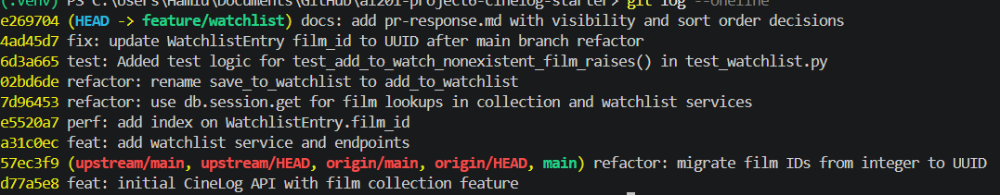

# PR Response Doc — CineLog Watchlist Feature

## AI Usage
<!-- Fill in at the end — how you used AI tools during this project -->

I asked Claude to find every reference of save_to_watchlist() and when it mapped them I changed every reference to add_to_watchlist(). While choosing my position on question 4 I asked claude what were some tradebacks to my logic and it gave me back a list of tradebacks. From there I took the most logical/ significant tradeback and relayed it.

## Comment 1 — Rename
**What I did:**  I asked Claude to find every reference of save_to_watchlist() and when it mapped them I changed every reference to add_to_watchlist().

**How I verified:**
I verified it by asking claude to check that save_to_watchlist() was no longer referenced and that add_to_watchlist() had replaced it. It then ran a grep on save_to_watchlist() and add_to_watchlist().

## Comment 2 — Deduplication
**What I did:** I read the logic within the collection service and applied the same logic to the add_to_watchlist()

**How I verified:** I verified this by creating a separate test case for checking for deduplication in the test suite.

## Comment 3 — Missing test
**What I did:** I looked into the testcase, test_add_to_collection_nonexistent_film_raises(), in test_collection and replicated in test_watchlist with test_add_to_watch_nonexistent_film_raises()
**How I verified:** I verified it by running the test suite and seeing if it passed or failed

## Comment 4 — Default visibility
**My position:** I believe this should be changed to False
**Reasoning:** I dont think everyone should be able to grab other users watchlist. To me I think this might be an invasion of privacy to users. There should at least be the option for users to public or private that information
**Tradeoff acknowledged:** A trade off for changing public to False would be adding more work on users to request information, but in return we would have a safer privacy default.

## Comment 5 — Sort order
**My position:** I would like it to remain in alphabetic 
**Reasoning:** Sorting by date would allow users to see what they added recently easier but it would create a mess when considering shows added further back in time. By keeping it in alphabetical order regardless of when the show was added users will be easily be able to find their shows

**Engagement with reviewer's point:** I understand that seeing the most recent adds is convenient but that convenience comes at the cost of being able to easily find shows that were added months or even years back.

## Comment 6 — Rebase
**What conflicted:** CONFLICT (content): Merge conflict in models.py. Main switched film IDs from integers to UUID string and my comment changed that same line and added index=True
**How I resolved it:**  I kept both changes in models in one line in models.py line 81
**How I verified no conflict remains:** I hit git rebase --continue to see if any conflicts remained and from there I merged changes and sucessfully rebased.

## PR Description

### feat: add watchlist feature

**What this PR does:** This PR adds a watchlist feature so users can save films they want to watch later. I rebased my branch onto main after main switched film IDs from integers to UUIDs.

**What I changed:**
- I added two endpoints in routes/watchlist/watchlist.py and registered them in app.py. GET /watchlist/<user_id> returns a user's watchlist in alphabetical order, and POST /watchlist/<user_id>/add adds a film to it.
- I renamed save_to_watchlist() to add_to_watchlist() and added the same deduplication logic the collection service uses, so adding the same film twice returns the entry that already exists instead of making a duplicate.
- I added index=True to film_id in the WatchlistEntry model and kept the UUID change from main on the same line.
- I changed Film.query.get() to db.session.get() in both the collection and watchlist services, since Film.query.get() is deprecated.
- I added tests in test_watchlist.py for deduplication and for adding a film that doesn't exist.

**Decisions from review:**
- Sort order: I kept it alphabetical so users can still easily find films they added a long time ago. More on this in Comment 5.
- Default visibility: I think public should default to False for privacy reasons, but I haven't changed it in this PR yet. More on this in Comment 4.

**How I verified:** I ran the test suite and all 6 tests passed.

**What still needs fixing:**
- The add endpoint doesn't catch FilmNotFoundError, so adding a film that doesn't exist gives a 500 error instead of a 404.
- The nonexistent film test still uses an integer ID (99999) when it should be using a UUID.
- The route docstring still says film_id is an int.

